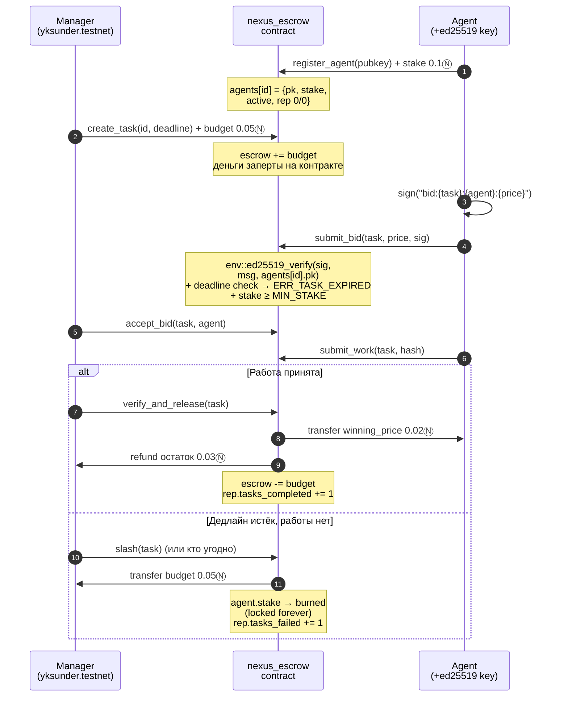

# nexus_escrow — NEAR Testnet

Смарт-контракт эскроу для агентной экономики NEXUS (хакатон): агенты
стейкуют, делают **ed25519-подписанные** ставки, менеджер escrow'ит бюджет
и выплачивает за подтверждённую работу; просрочка → refund + сжигание
стейка. Версия **v2**: дедлайн-защита bid'ов, on-chain репутация,
escrow-счётчик.

**Contract ID:** `nexus-escrow.yksunder.testnet`
(faucet `helper.testnet.near.org` недоступен — саб-аккаунт
`yksunder.testnet`; логика идентична для `nexus-escrow.testnet`)

## Architecture Flow



Деньги: `Manager → escrow (contract balance) → Agent / Manager-refund`.
Подпись bid проверяется **внутри контракта** host-функцией
`env::ed25519_verify` — off-chain компрометация менеджера не позволяет
подделать ставку без ключа агента.

## Методы

| Метод | Роль | Действие |
|---|---|---|
| `register_agent(public_key)` | agent, payable ≥ MIN_STAKE (0.1Ⓝ) | ed25519-ключ + стейк в реестр; повторная ре-активация сохраняет репутацию |
| `create_task(task_id, deadline_ms)` | любой, payable = бюджет | бюджет → эскроу (`escrow += budget`) |
| `submit_bid(task_id, price_yocto, signature)` | agent | `ed25519_verify` подписи `bid:{task}:{agent}:{price}`; **дедлайн истёк → `ERR_TASK_EXPIRED`**; стейк ≥ MIN_STAKE |
| `accept_bid(task_id, agent_id)` | manager | фиксация победителя |
| `submit_work(task_id, work_hash)` | winner | хэш результата |
| `verify_and_release(task_id)` | manager | winning_price → агенту, остаток → менеджеру; `tasks_completed += 1` |
| `slash(task_id)` | после deadline, Awarded | бюджет → менеджеру, стейк сжигается (`burned` += стейк); `tasks_failed += 1` |
| `refund_open_task(task_id)` | manager, Open+deadline | возврат эскроу без победителя |
| `get_agent` | view | `{public_key, stake, active, tasks_completed, tasks_failed}` (JSON) |
| `get_task / get_bids` | view | состояние задачи / список bid'ов |
| `get_burned` | view | суммарно сожженный стейк (yocto) |
| `get_escrow_balance` | view | Σ живых бюджетов в эскроу — «0.05 → 0» |
| `get_contract_balance` | view | сырой баланс аккаунта контракта |

## Подтверждение на testnet — v2 (текущий код)

| Шаг | TxHash |
|---|---|
| deploy v2 (rep+escrow+deadline) | `CBFpsgjCMPSvZHM692R1vM9GjyRJS9caYqVtuoc9q9qK` |
| migrate v1→v2 (сохранил burned=1Ⓝ) | `7bKyq9YWJtt3edBQ514zoTfBGsnRKRP7xtoPYw9aEACk` |
| deploy v2.1 (MIN_STAKE→0.1Ⓝ) | `8gu3s5dWZr9mVKjTLkdiztKdZKueifcUKhja778iGnbF` |
| register_agent (0.1Ⓝ stake) | `4ppbsWwu1LSjePJZjfP3Kh2hKFE2BF83Y5yoNGjgKKYZ` |
| create_task `v2-expired` | `2r1tJwLtPyxeXBcNqp7uPVtNdHG2rXc68p2yj88vwtL1` |
| **submit_bid → `ERR_TASK_EXPIRED`** (отклонён) | `GA1ZCSAfTYXUUx6KToBvg8ScPDjTYKEF9c7uyqukZCQo` |
| refund_open_task | `cEVgYF9qrjZTyxoCpSPgB6WBhHczN9vu1Cs14Jne7pp` |
| create_task `v2-happy` (0.05Ⓝ) | `GmfsGB841PpwzVhvW6DgMA92FUTjmaephq9QKXN1kn91` |
| submit_bid (ed25519 ✓) | `hQXYZV6EVW5JUdCdscZCChyCsRGpPRzVKqtTaMXs369` |
| accept_bid | `6jfTxndwP3fnC817CazjTkzQTigpDU9Gi1cCzNa5zvgm` |
| submit_work | `6RQ9RE5pyo2YeUY1EXZq17QLigWnJZULjctCSf2iKJku` |
| verify_and_release (rep+1) | `AppXSyRH4gogL8jxS5Jcf3ToXSSYQkSFZYPrZToCV92h` |
| create_task `v2-slash` | `AcPpRF4VLiEwv9DV8LWXvtNbJhzuaMGQBVRLBkpWDxR2` |
| submit_bid | `AssJmiy6rRWpPZ48BhNo7FwXtkxgqEk93Z8TZFF7bNbj` |
| accept_bid | `BUmyFSRQegKKzGHNUEPdPnivmvpP3sRWPrMGqCLVKiGX` |
| **slash → burn 0.1Ⓝ, rep−1** | `8HNf4ktZPYB1cvcAbDStf39HaSoiyXVFS8Dh5uPnZdib` |

Финальное состояние (view, settled):
`get_agent` → `{stake:"0", active:false, tasks_completed:1, tasks_failed:1}`;
`get_escrow_balance` → `0`; `get_burned` → `1.1e24` yocto (1Ⓝ из v1 +
0.1Ⓝ из v2-демо).

## v1 (первая версия, 8 методов — история сохранена)

| Шаг | TxHash |
|---|---|
| create-account | `Fr4Qdv7r6rMrezSpEsPCwDvxNvRDv9Zw7mBpSVLrFio5` |
| deploy + new | `8nHU8oSZ6GU1pQP55PZo7Y9wEkzzsfM5ZjS7ZaE9znvG` |
| register_agent (1Ⓝ) | `GTpeSW2Qc4XuXJVHfMYzGqkdAkMhEXr6o2GAmAxBV8ss` |
| create_task | `5McsXYVuctURLPmG5eWEXET6FCpNyeQtoWrA8KmnkEjr` |
| submit_bid | `5wYrLQWNV5LE2DdbiAvuvpcXoLiwR2FpGyidyNo1naYQ` |
| accept_bid | `47vsVkH5YBHKfxSS4dVLe8k6F9dGhq5TxSiowe9TXq5G` |
| submit_work | `9ZViFrz9QMuY8FQxwSvv9sYWqWFJphRw4R2uu7DWR3s9` |
| verify_and_release | `8SfXrUsexYmhor7RqaLT4PbWtGyB2bLDYztJB27R6gRN` |
| slash (burn 1Ⓝ) | `APoUwEitPJP2LbbXVhzyQzpgdU5AjYv6P4XbncPqVnhE` |

## Миграция v1 → v2

Layout поменялся (`Agent` +2 поля, root +`escrow`), старые записи не
десериализуются → `migrate(owner, carried_burned)` (`#[init(ignore_state)]`
+ `#[private]`, вызывается ключом самого контракт-аккаунта). Реестр и
задачи пересоздаются с новыми префиксами хранилища; `burned` перенесён
честно (1Ⓝ реально заперт на аккаунте). События v1 — по tx-хэшам выше.

## Сборка и деплой

```bash
rustup target add wasm32-unknown-unknown
cargo build --target wasm32-unknown-unknown --release   # → nexus_escrow.wasm
bash contracts/nexus_escrow/deploy.sh <contract> <master>
```

## Прогон демо

Рекомендуемый путь — Python-драйвер (pure-Python ed25519+Borsh, показывает
текст паник контракта, которые near-cli обрезает):

```bash
python contracts/nexus_escrow/chain_demo.py            # полный цикл (~2 мин)
python contracts/nexus_escrow/chain_demo.py views      # только view-дамп
```

Или через near-cli: `demo_calls.sh` — те же вызовы + проверка балансов.
NB: `rpc.testnet.near.org` деприкейтнут (429) — скрипты ходят через
`https://test.rpc.fastnear.com`.

## Подпись bid (формат)

```python
seed32, pk32 = near_rpc.parse_near_private_key(NEAR_PRIVATE_KEY)
sig = near_rpc.ed25519_sign(b"bid:{task}:{agent}:{price_yocto}", seed32, pk32)
signature_b58 = near_rpc.b58encode(sig)   # → submit_bid.signature
```
